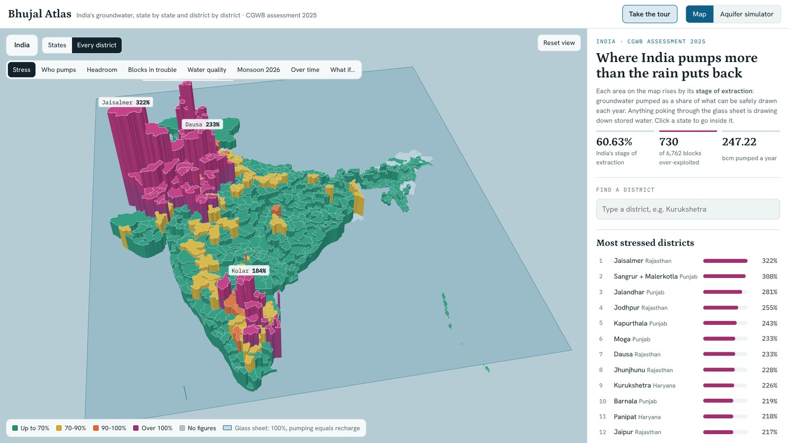
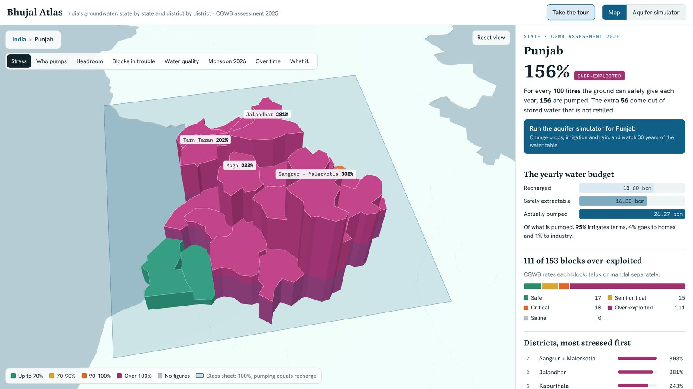
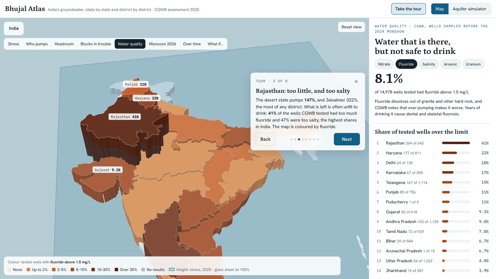

# Bhujal Atlas

**India's groundwater, state by state and district by district, in 3D.**

Live: https://vin-yadav.github.io/bhujal-atlas/

Each area rises by its *stage of extraction*: groundwater pumped as a share of what can be safely drawn each year. A glass sheet marks 100%. Anything poking through it is drawing down stored water that the rain does not refill. In CGWB's 2025 assessment, 89 districts do.

## What you can do

- **Drill down** from India to any state and any district, with its yearly water budget and block ratings.
- **Switch lenses:** stress, who pumps it (farms, homes, industry), headroom, blocks in trouble, water quality (nitrate, fluoride, salinity, arsenic, uranium), the 2026 monsoon, a 2017–2025 time machine, and what-if scenarios.
- **What if…** scale farm pumping, city and industry demand, and recharge for every district, and watch the count of over-exploited districts change.
- **Take the tour:** eight stops from the Punjab paddy belt to arsenic in Bengal.
- **Compare** any two districts side by side.
- **Aquifer simulator:** a 3D village in Punjab or Haryana. Change crops, drip irrigation, monsoons and rock type, and watch 30 years of the water table.

| | |
|---|---|
|  |  |

## Data

- Central Ground Water Board (CGWB), *National Compilation on Dynamic Ground Water Resources of India, 2025*: district recharge, extraction and stage of extraction, and block categories.
- State figures for 2017 and 2020 from the Ministry of Jal Shakti's Lok Sabha answer of 4 August 2022 (Unstarred Q. 3018); 2022, 2023 and 2024 from CGWB's national compilations.
- CGWB *Annual Ground Water Quality Report 2025* (wells sampled before the 2024 monsoon).
- ICAR-CRIDA rainfall bulletin for 1 June to 29 September 2026, built on IMD data.
- District boundaries: [india-maps-data](https://github.com/udit-001/india-maps-data), with Andhra Pradesh's new districts from [INDIAN-SHAPEFILES](https://github.com/datta07/INDIAN-SHAPEFILES), simplified. Boundaries are indicative.

Every state's district figures were checked to add up to the state totals in the source, and each year's states to that year's national total. "Headroom" and "What if…" are simple arithmetic on CGWB's budgets, explained on the page. The simulator is a teaching model of one typical village, not a forecast.

## How it's built

One self-contained `index.html`: the data is embedded, and 3D rendering uses [three.js](https://threejs.org/) r128 from a CDN. No build step and no server. Open the file in a browser, or host it anywhere static.
